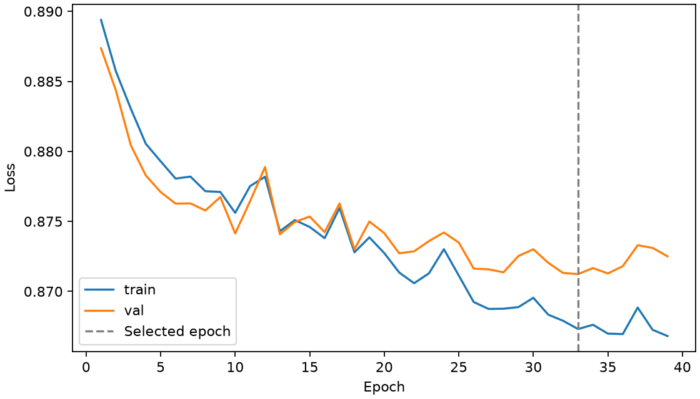
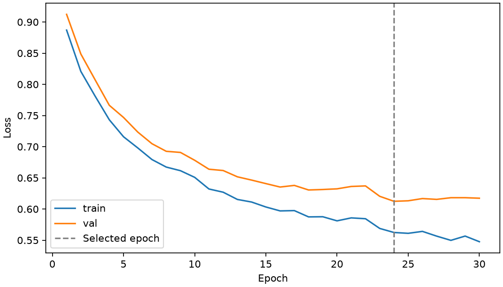
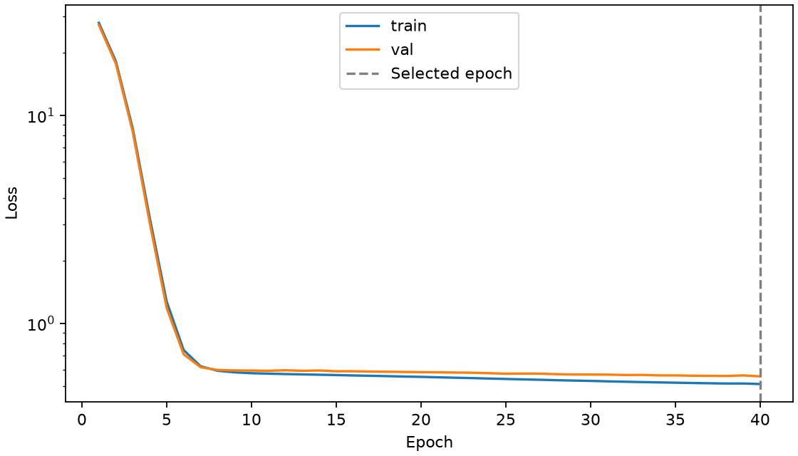
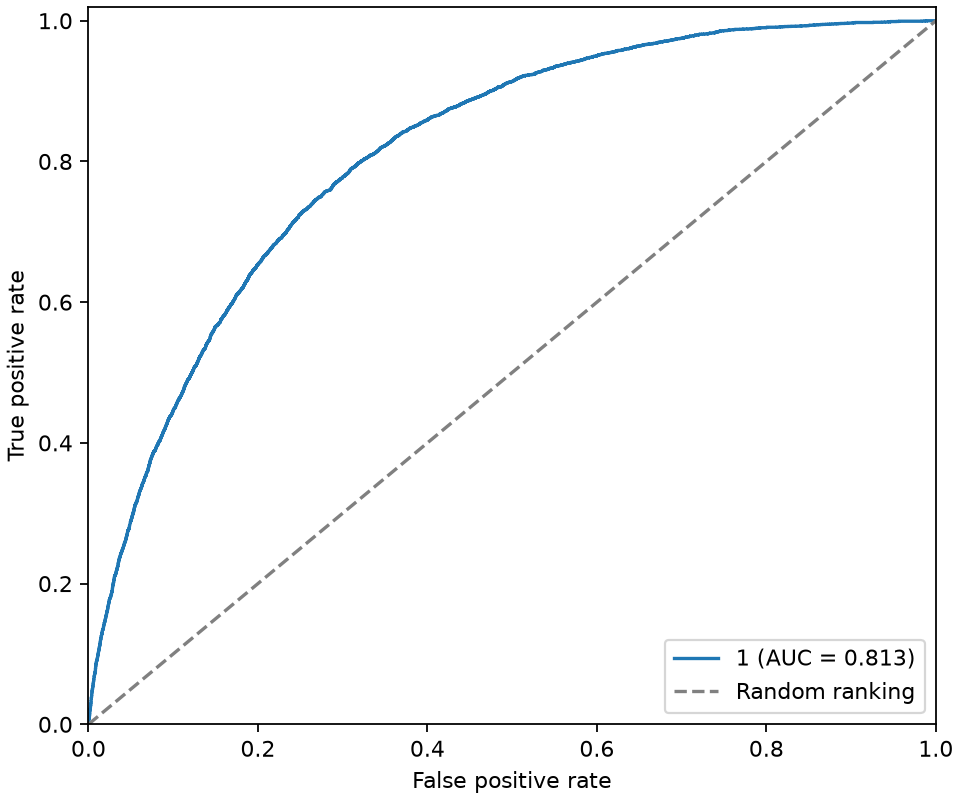
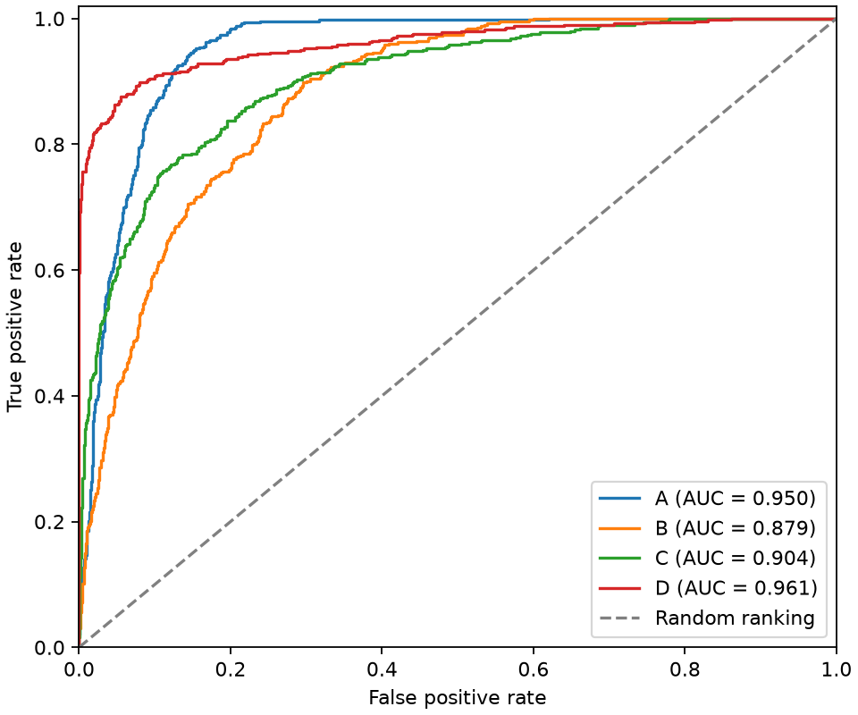
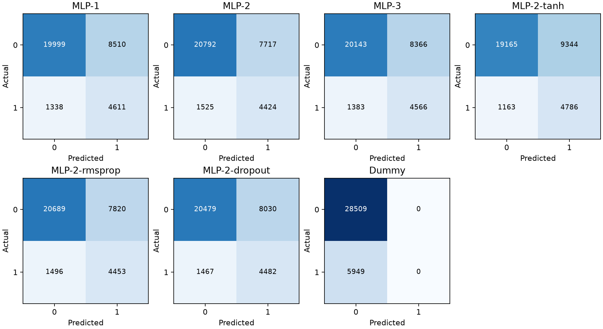
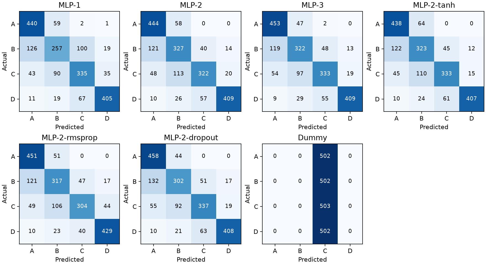

# Задание № 1. Полносвязные нейронные сети прямого распространения

Дисциплина «Нейронные сети». Вариант с нечётной последней цифрой дня рождения.

Студент: ____________________ · Группа: __________ · Дата: __________

**Цель работы** — подготовить табличные данные и сравнить полносвязные нейронные сети для бинарной классификации, многоклассовой классификации и регрессии. Для каждой задачи исследуются архитектуры и параметры обучения, проводится сравнение с базовой моделью и проверяется переобучение.

## 1. Описание наборов данных

| Набор | Задача и цель | Строк × столбцов | Типы исходных столбцов | Пустых ячеек | Точных повторов сверх первого |
| --- | --- | ---: | --- | ---: | ---: |
| Diabetes Health Indicators | Бинарная классификация по `Diabetes_012` | 253 680 × 22 | 22 числовых, включая коды категорий и целевой столбец | 0 | 23 899 |
| Body Performance | Многоклассовая классификация по `class` | 13 393 × 12 | 10 числовых, 2 строковых (`gender` и `class`) | 0 | 1 |
| Wine Quality, белое вино | Регрессия по `quality` | 4 898 × 12 | 11 вещественных, целевой столбец целочисленный | 0 | 937 |

- **Diabetes Health Indicators.** Ответы на опрос BRFSS 2015 о состоянии здоровья, привычках и доступе к медпомощи. [Карточка Kaggle](https://www.kaggle.com/datasets/alexteboul/diabetes-health-indicators-dataset) · [Документация CDC](https://www.cdc.gov/brfss/annual_data/annual_2015.html)
- **Body Performance.** Антропометрические данные, артериальное давление и результаты физических тестов. [Карточка Kaggle](https://www.kaggle.com/datasets/kukuroo3/body-performance-data)
- **Wine Quality.** Лабораторные измерения образцов белого вина Vinho Verde и их сенсорные оценки. [Карточка UCI](https://archive.ics.uci.edu/dataset/186/wine%2Bquality)

### Распределение целевых классов до обработки

| Набор | Исходный класс | Строк | Доля |
| --- | --- | ---: | ---: |
| Diabetes | 0 — без диабета | 213 703 | 84,24% |
| Diabetes | 1 — преддиабет | 4 631 | 1,83% |
| Diabetes | 2 — диабет | 35 346 | 13,93% |
| Body Performance | A | 3 348 | 25,00% |
| Body Performance | B | 3 347 | 24,99% |
| Body Performance | C | 3 349 | 25,01% |
| Body Performance | D | 3 349 | 25,01% |

Для бинарной задачи метку `0` сохранили, а исходные `1` и `2` объединили в положительный класс `1`. До удаления повторов в положительном классе 39 977 строк (15,76%). Для Body Performance использовали коды A → 0, B → 1, C → 2, D → 3.

### Описательная статистика Wine Quality до обработки

Статистика рассчитана по 4 898 строкам. Q1 и Q3 обозначают 25-й и 75-й процентили. Стандартное отклонение выборочное.

| Столбец | Среднее | Станд. откл. | Мин. | Q1 | Медиана | Q3 | Макс. |
| --- | ---: | ---: | ---: | ---: | ---: | ---: | ---: |
| fixed acidity | 6,85479 | 0,843868 | 3,8 | 6,3 | 6,8 | 7,3 | 14,2 |
| volatile acidity | 0,278241 | 0,100795 | 0,08 | 0,21 | 0,26 | 0,32 | 1,1 |
| citric acid | 0,334192 | 0,12102 | 0 | 0,27 | 0,32 | 0,39 | 1,66 |
| residual sugar | 6,39141 | 5,07206 | 0,6 | 1,7 | 5,2 | 9,9 | 65,8 |
| chlorides | 0,0457724 | 0,021848 | 0,009 | 0,036 | 0,043 | 0,05 | 0,346 |
| free sulfur dioxide | 35,3081 | 17,0071 | 2 | 23 | 34 | 46 | 289 |
| total sulfur dioxide | 138,361 | 42,4981 | 9 | 108 | 134 | 167 | 440 |
| density | 0,994027 | 0,00299091 | 0,98711 | 0,991723 | 0,99374 | 0,9961 | 1,03898 |
| pH | 3,18827 | 0,151001 | 2,72 | 3,09 | 3,18 | 3,28 | 3,82 |
| sulphates | 0,489847 | 0,114126 | 0,22 | 0,41 | 0,47 | 0,55 | 1,08 |
| alcohol | 10,5143 | 1,23062 | 8 | 9,5 | 10,4 | 11,4 | 14,2 |
| **quality** | **5,87791** | **0,885639** | **3** | **5** | **6** | **6** | **9** |

### Проверка выбросов

Для количественных столбцов проверили выход за границы Q1 − 1,5 × IQR и Q3 + 1,5 × IQR, где IQR — разность Q3 и Q1. Это описательная проверка исходных CSV. Её границы не используются для преобразования или фильтрации выборок.

| Набор | Примеры столбцов с отметками IQR |
| --- | --- |
| Diabetes | `PhysHlth` — 40 949, `MentHlth` — 36 208, `BMI` — 9 847 |
| Body Performance | `sit and bend forward_cm` — 409, `weight_kg` — 83, `body fat_%` — 77 |
| Wine Quality | `citric acid` — 270, `chlorides` — 208, `quality` — 200, `volatile acidity` — 186 |

Редкие оценки вина и крайние измерения сохранили. Правило IQR отмечает часть допустимых значений, особенно у асимметричных распределений. Отдельно исправили только явно противоречивые пары давления, описанные ниже.

## 2. Признаки и подготовка данных

### Отбор признаков

Списки входных столбцов заданы явно. Целевые столбцы отделены от признаков. Идентификаторов записей в исходных CSV не обнаружили. Индекс строки хранится отдельно для проверки разбиения.

| Набор | Числовые признаки для масштабирования | Категории для One-Hot Encoding | Бинарные признаки в исходном коде 0/1 |
| --- | --- | --- | --- |
| Diabetes | `BMI`, `MentHlth`, `PhysHlth` | `GenHlth`, `Age`, `Education`, `Income` | `HighBP`, `HighChol`, `CholCheck`, `Smoker`, `Stroke`, `HeartDiseaseorAttack`, `PhysActivity`, `Fruits`, `Veggies`, `HvyAlcoholConsump`, `AnyHealthcare`, `NoDocbcCost`, `DiffWalk`, `Sex` |
| Body Performance | `age`, `height_cm`, `weight_kg`, `body fat_%`, `diastolic`, `systolic`, `gripForce`, `sit and bend forward_cm`, `sit-ups counts`, `broad jump_cm` | `gender` | — |
| Wine Quality | `fixed acidity`, `volatile acidity`, `citric acid`, `residual sugar`, `chlorides`, `free sulfur dioxide`, `total sulfur dioxide`, `density`, `pH`, `sulphates`, `alcohol` | — | — |

Для Diabetes признаки описывают ответы на отдельные вопросы анкеты, а статус диабета задаёт целевой столбец. Задача относится к классификации статуса в рамках опроса. Для Body Performance класс предсказывается после проведения физических тестов, поэтому их результаты включены во входные данные. В CSV отсутствует отдельный итоговый балл, а правило присвоения класса по измерениям не установлено. Для Wine Quality входы содержат лабораторные показатели, а целевая сенсорная оценка сохраняется в исходной шкале. [Документация BRFSS](https://www.cdc.gov/brfss/annual_data/2015/pdf/codebook15_llcp.pdf) · [Описание Wine Quality](https://archive.ics.uci.edu/dataset/186/wine%2Bquality)

### Очистка и разбиение

1. В Body Performance пометили оба показателя давления пропущенными в пяти строках. В одной строке оба значения равны нулю, в четырёх систолическое давление ниже диастолического.
2. После кодирования цели и проверки давления оставили по одной записи на каждую точную комбинацию входов и цели. Удалили 23 968 повторов Diabetes, 1 повтор Body Performance и 937 повторов Wine Quality. Разница между 23 899 и 23 968 для Diabetes появилась после объединения исходных меток `1` и `2`. Доля положительного класса после удаления повторов выросла с 15,76% до 17,26%. При отсутствии идентификаторов одинаковые записи могут принадлежать разным респондентам, поэтому это решение меняет частоты наблюдаемых профилей.
3. Сначала случайно отделили около 30% уникальных входных профилей, затем поровну поделили их между валидацией и тестом. Оба вызова `train_test_split` используют `random_state=42`. Для классификации применили стратификацию по набору меток каждого профиля. В Diabetes осталось 1 804 профиля, для которых встречаются обе бинарные метки. Обе записи каждого такого профиля попали в одну часть. Для регрессии использовали случайное разбиение профилей без стратификации.

| Набор | Обучение | Валидация | Тест | Всего после очистки | Входов после обработки |
| --- | ---: | ---: | ---: | ---: | ---: |
| Diabetes | 160 798 | 34 456 | 34 458 | 229 712 | 49 |
| Body Performance | 9 374 | 2 009 | 2 009 | 13 392 | 12 |
| Wine Quality | 2 772 | 594 | 595 | 3 961 | 11 |

В Diabetes доля положительного класса во всех частях составляет около 17,26%. В Body Performance каждый класс занимает около четверти каждой части. У Wine Quality все пять образцов с оценкой 9 попали в обучение, поэтому по валидации и тесту качество прогноза для этой оценки измерить нельзя.

### Преобразования, обучаемые на обучающей части

- Числовые пропуски заполнили медианой своего столбца, затем применили `StandardScaler`. Медиана уменьшает влияние крайних значений на заполнение пропусков.
- Для категорий предусмотрели заполнение модой, затем применили `OneHotEncoder` с игнорированием новых категорий. Бинарные признаки Diabetes уже закодированы числами 0 и 1, для них предусмотрено только заполнение модой. В исходных CSV пропусков в этих двух группах нет.
- Все параметры преобразований рассчитали только на обучающей части. Для валидации и теста применили готовые преобразования без повторной подгонки. [Рекомендации scikit-learn по предотвращению утечки](https://scikit-learn.org/stable/common_pitfalls.html)

### Воспроизведение

Из корня проекта выполнить `.\.venv\Scripts\python.exe prepare_data.py`. Скрипт [prepare_data.py](prepare_data.py) читает исходные CSV из `data/raw` и сохраняет по одному архиву `.npz` на набор в `data/processed`. В архивах находятся массивы `X_train`, `y_train`, `X_val`, `y_val`, `X_test`, `y_test`, имена признаков, имена классов для классификации и нулевые индексы исходных строк для каждой части.

## 3. Архитектуры и параметры обучения

Для каждой задачи сравниваются три архитектуры разной глубины и ширины. Ещё три эксперимента меняют по одному параметру MLP-2, чтобы отдельно сравнить активацию, оптимизатор и Dropout.

| Модель | Скрытые слои | Активация | Оптимизатор | Dropout после каждого скрытого слоя |
| --- | --- | --- | --- | ---: |
| MLP-1 | 32 | ReLU | Adam | 0 |
| MLP-2 | 64, 32 | ReLU | Adam | 0 |
| MLP-3 | 128, 64, 32 | ReLU | Adam | 0 |
| MLP-2-tanh | 64, 32 | Tanh | Adam | 0 |
| MLP-2-rmsprop | 64, 32 | ReLU | RMSprop | 0 |
| MLP-2-dropout | 64, 32 | ReLU | Adam | 0,15 |

| Задача | Входы | Выход и функция потерь | Размер пакета |
| --- | ---: | --- | ---: |
| Diabetes | 49 | Один логит, `BCEWithLogitsLoss`. Для оценки применён sigmoid | 1 024 |
| Body Performance | 12 | Четыре логита, `CrossEntropyLoss`. Для оценки применён softmax | 128 |
| Wine Quality | 11 | Один линейный выход, `MSELoss`. Оценка в исходной шкале | 128 |

Скорость обучения 0,001, максимум 40 эпох. Веса и перемешивание обучающих пакетов инициализированы с seed 42. Early Stopping отслеживает потерю на валидации: обучение прекращается после шести эпох без улучшения более чем на 0,00001, восстанавливаются веса лучшей эпохи. В Diabetes положительный класс взвешен в функции потерь отношением численностей отрицательного и положительного классов на `train` (133 038 / 27 760 ≈ 4,79).

Победитель фиксируется по Balanced Accuracy на `validation` для классификации и по MSE для регрессии. Для каждой модели Diabetes порог выбирается на `validation` по максимуму Balanced Accuracy, при равенстве берётся ближайший к 0,5. Все зафиксированные модели оцениваются на общем тесте. Базовые модели обучаются на `train`: `DummyClassifier(strategy="prior")` для классификации и `DummyRegressor(strategy="mean")` для регрессии.

## 4. Графики обучения

Пунктир обозначает эпоху, веса которой восстановлены по валидационной потере. Потери обеих выборок рассчитаны после окончания эпохи при отключённом Dropout. Для Wine Quality вертикальная шкала логарифмическая, чтобы показать динамику после резкого снижения потери в первые эпохи.

| Diabetes | Body Performance | Wine Quality |
| --- | --- | --- |
|  |  |  |

## 5. ROC-кривые

Для Diabetes ROC построена по оценкам положительного класса. Для Body Performance использована схема One-vs-Rest для классов A–D. На обеих диаграммах показаны модели, выбранные по валидации, а кривые рассчитаны по общему тесту соответствующей задачи.

| Diabetes | Body Performance |
| --- | --- |
|  |  |

## 6. Результаты на тестовых выборках

В таблицах жирным выделена модель, заранее выбранная по валидации. Balanced Accuracy — среднее значение Recall по классам. Для метрик, зависящих от класса, деление на ноль при отсутствии положительных прогнозов даёт 0.

### Diabetes

| Модель | Balanced Accuracy val | Порог | Recall test | Precision test | Balanced Accuracy test | ROC-AUC test |
| --- | --- | --- | --- | --- | --- | --- |
| MLP-1 | 0,7364 | 0,5074 | 0,7751 | 0,3514 | 0,7383 | 0,8123 |
| MLP-2 | 0,7357 | 0,5436 | 0,7437 | 0,3644 | 0,7365 | 0,8115 |
| MLP-3 | 0,7362 | 0,5252 | 0,7675 | 0,3531 | 0,7370 | 0,8120 |
| **MLP-2-tanh** | 0,7376 | 0,4823 | 0,8045 | 0,3387 | 0,7384 | 0,8132 |
| MLP-2-rmsprop | 0,7351 | 0,5248 | 0,7485 | 0,3628 | 0,7371 | 0,8114 |
| MLP-2-dropout | 0,7362 | 0,5364 | 0,7534 | 0,3582 | 0,7359 | 0,8120 |
| Dummy | — | 0,5000 | 0,0000 | 0,0000 | 0,5000 | 0,5000 |



MLP-2-tanh правильно нашла 4 786 из 5 949 положительных случаев и дала 9 344 ложных срабатывания. Порог 0,4823 обеспечивает Recall 0,8045, но Precision составляет 0,3387. Дисбаланс классов и значительное число ложных срабатываний ограничивают точность положительных прогнозов. ROC-AUC достигла ориентира 0,80, Balanced Accuracy осталась ниже него. У Dummy обычная Accuracy составляет 0,8274, хотя он пропустил все положительные случаи.

### Body Performance

| Модель | Balanced Accuracy val | Balanced Accuracy test | Macro ROC-AUC test |
| --- | --- | --- | --- |
| MLP-1 | 0,6879 | 0,7153 | 0,9014 |
| MLP-2 | 0,7381 | 0,7477 | 0,9196 |
| **MLP-3** | 0,7471 | 0,7551 | 0,9233 |
| MLP-2-tanh | 0,7352 | 0,7472 | 0,9196 |
| MLP-2-rmsprop | 0,7302 | 0,7472 | 0,9199 |
| MLP-2-dropout | 0,7381 | 0,7492 | 0,9231 |
| Dummy | — | 0,2500 | 0,5000 |

В каждой ячейке следующей таблицы указаны Precision / Recall / F1.

| Модель | A | B | C | D | Macro avg | Weighted avg |
| --- | --- | --- | --- | --- | --- | --- |
| MLP-1 | 0,7097 / 0,8765 / 0,7843 | 0,6047 / 0,5120 / 0,5545 | 0,6647 / 0,6660 / 0,6653 | 0,8804 / 0,8068 / 0,8420 | 0,7149 / 0,7153 / 0,7115 | 0,7149 / 0,7153 / 0,7115 |
| MLP-2 | 0,7127 / 0,8845 / 0,7893 | 0,6240 / 0,6514 / 0,6374 | 0,7685 / 0,6402 / 0,6985 | 0,9233 / 0,8147 / 0,8656 | 0,7571 / 0,7477 / 0,7477 | 0,7571 / 0,7476 / 0,7477 |
| **MLP-3** | 0,7134 / 0,9024 / 0,7968 | 0,6505 / 0,6414 / 0,6459 | 0,7603 / 0,6620 / 0,7078 | 0,9274 / 0,8147 / 0,8674 | 0,7629 / 0,7551 / 0,7545 | 0,7629 / 0,7551 / 0,7545 |
| MLP-2-tanh | 0,7122 / 0,8725 / 0,7842 | 0,6200 / 0,6434 / 0,6315 | 0,7585 / 0,6620 / 0,7070 | 0,9378 / 0,8108 / 0,8697 | 0,7571 / 0,7472 / 0,7481 | 0,7571 / 0,7471 / 0,7481 |
| MLP-2-rmsprop | 0,7147 / 0,8984 / 0,7961 | 0,6378 / 0,6315 / 0,6346 | 0,7775 / 0,6044 / 0,6801 | 0,8755 / 0,8546 / 0,8649 | 0,7514 / 0,7472 / 0,7439 | 0,7514 / 0,7471 / 0,7439 |
| MLP-2-dropout | 0,6992 / 0,9124 / 0,7917 | 0,6580 / 0,6016 / 0,6285 | 0,7472 / 0,6700 / 0,7065 | 0,9189 / 0,8127 / 0,8626 | 0,7558 / 0,7492 / 0,7473 | 0,7558 / 0,7491 / 0,7473 |
| Dummy | 0,0000 / 0,0000 / 0,0000 | 0,0000 / 0,0000 / 0,0000 | 0,2504 / 1,0000 / 0,4005 | 0,0000 / 0,0000 / 0,0000 | 0,0626 / 0,2500 / 0,1001 | 0,0627 / 0,2504 / 0,1003 |

ROC-AUC по классам, One-vs-Rest:

| Модель | A | B | C | D |
| --- | --- | --- | --- | --- |
| MLP-1 | 0,9430 | 0,8420 | 0,8647 | 0,9559 |
| MLP-2 | 0,9473 | 0,8747 | 0,8956 | 0,9609 |
| **MLP-3** | 0,9498 | 0,8789 | 0,9036 | 0,9609 |
| MLP-2-tanh | 0,9485 | 0,8729 | 0,8961 | 0,9607 |
| MLP-2-rmsprop | 0,9486 | 0,8744 | 0,8960 | 0,9606 |
| MLP-2-dropout | 0,9502 | 0,8801 | 0,8987 | 0,9632 |
| Dummy | 0,5000 | 0,5000 | 0,5000 | 0,5000 |



MLP-3 превысила ориентир 0,80 по macro ROC-AUC (0,9233). Её Balanced Accuracy составила 0,7551. Наиболее трудным оказался класс B с Recall 0,6414. Из 502 объектов этого класса модель отнесла 119 к A. Класс C часто смешивался с B (97 из 503 объектов).

### Wine Quality

| Модель | MSE val | MSE test ↓ | MAE test ↓ | R² test ↑ |
| --- | --- | --- | --- | --- |
| MLP-1 | 1,1957 | 1,6352 | 0,9241 | −1,0829 |
| MLP-2 | 0,5917 | 0,5659 | 0,5907 | 0,2792 |
| MLP-3 | 0,5659 | 0,5990 | 0,5962 | 0,2371 |
| **MLP-2-tanh** | 0,5556 | 0,5518 | 0,5783 | 0,2972 |
| MLP-2-rmsprop | 0,5695 | 0,5415 | 0,5796 | 0,3103 |
| MLP-2-dropout | 0,5949 | 0,6438 | 0,6138 | 0,1799 |
| Dummy | — | 0,7860 | 0,6719 | −0,0012 |

MLP-2-tanh снизила тестовую MSE примерно на 30% относительно прогноза средним. Тестовый MAE составил 0,5783 балла, R² — 0,2972. RMSprop дал меньшую MSE на тесте, но модель была выбрана по валидации, где Tanh показал лучший результат. Тест не содержит оценок 9, поэтому результат относится к оценкам 3–8.

### Остановка обучения и переобучение

В ячейках указаны номер восстановленной эпохи и общее число выполненных эпох.

| Модель | Diabetes | Body Performance | Wine Quality |
| --- | --- | --- | --- |
| MLP-1 | 14 / 20 | 40 / 40 | 40 / 40 |
| MLP-2 | 10 / 16 | 39 / 40 | 40 / 40 |
| MLP-3 | 10 / 16 | 24 / 30 | 24 / 30 |
| MLP-2-tanh | 33 / 39 | 39 / 40 | 40 / 40 |
| MLP-2-rmsprop | 16 / 22 | 36 / 40 | 40 / 40 |
| MLP-2-dropout | 26 / 32 | 40 / 40 | 40 / 40 |

- **Diabetes.** У MLP-3 после 10-й эпохи обучающая потеря снизилась с 0,8614 до 0,8589, а валидационная выросла с 0,8733 до 0,8822. У выбранной MLP-2-tanh разрыв меньше. По валидационной Balanced Accuracy она опередила компактную MLP-1 всего примерно на 0,0012.
- **Body Performance.** После 24-й эпохи у MLP-3 обучающая потеря снизилась с 0,5624 до 0,5476, а валидационная выросла с 0,6124 до 0,6173. Early Stopping восстановил веса 24-й эпохи. Dropout немного снизил валидационную потерю MLP-2 (0,6357 против 0,6391), а Balanced Accuracy почти не изменилась.
- **Wine Quality.** У MLP-3 после лучшей эпохи обучающая потеря продолжила снижаться, а валидационная выросла с 0,5659 до 0,5691. У выбранной MLP-2-tanh минимум валидационной потери пришёлся на 40-ю эпоху, поэтому граница бюджета остановила обучение. Компактная MLP-1 также достигла этой границы и на тесте уступила прогнозу средним.

## 7. Программный код

Скрипты [prepare_data.py](prepare_data.py) и [train_models.py](train_models.py) запускаются из корня проекта в окружении `.venv`.

```powershell
.\.venv\Scripts\python.exe prepare_data.py
.\.venv\Scripts\python.exe train_models.py
```

В папке `results` сохранены веса лучших эпох всех MLP, графики и [metrics.json](results/metrics.json) с метриками, матрицами ошибок, порогами и историями обучения.

[Презентация для защиты](deliverables/lab-1-defense.pptx) содержит основные таблицы, графики и выводы по трём задачам.

## Заключение

Все три выбранные MLP превзошли базовые модели по основным метрикам своих задач. Увеличение глубины и ширины дало наиболее заметный выигрыш в Body Performance. В Diabetes разные архитектуры дали близкие результаты, а низкая Precision ограничила применение выбранного порога. В Wine Quality нелинейная модель улучшила прогноз средним, но объяснила около 30% дисперсии тестовой оценки. Эффекты измерены на одном разбиении с фиксированным seed. Для проверки устойчивости результатов можно повторить сравнение на нескольких разбиениях без изменения итоговой тестовой выборки.
